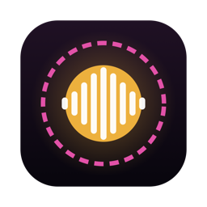
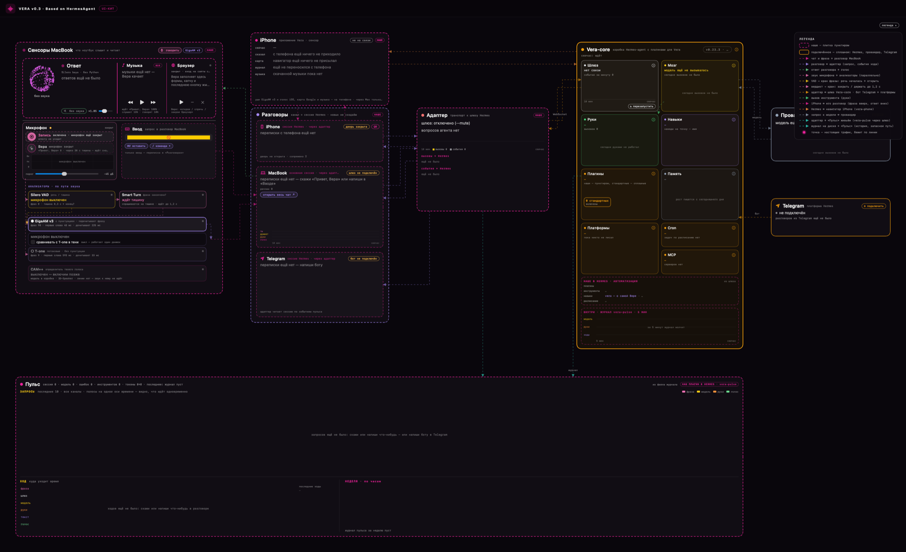
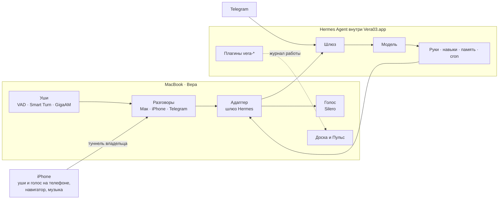

<div align="center">



# Вера

**Личный интерфейс к ИИ-агенту.** Мак и iPhone вокруг одного мозга, и всё, что он делает, видно на одной схеме.

[](#сборка)
[](docs/phone.md)
[](app/Package.swift)
[](https://github.com/NousResearch/hermes-agent)
[](LICENSE)



<sub>Доска Веры без подключения к агенту: каркас всех частей. Вживую по линиям бегут события, а в плитках — то, что агент сейчас делает.</sub>

</div>

---

## Что это

Модели меняются каждые несколько месяцев. Данные и то, как ты с ними работаешь, остаются. Вера построена на этой
мысли: **мозг сменный, интерфейс твой**.

В центре — один агент, [Hermes Agent](https://github.com/NousResearch/hermes-agent). Вера к нему подключает всё
остальное: уши и голос на Маке, приложение на iPhone для дороги, Telegram, свой браузер. И показывает на одной доске,
что агент слышит, о чём думает и что делает.

Это мастерская, а не продукт. Код открыт как пример подхода: собрать у себя можно, но придётся повозиться.

## Принципы

| | |
|---|---|
| 🧠 **Мозг один** | Вера сама не думает и моделей не вызывает. Решает и отвечает только Hermes; Вера — обвязка: окна, уши, голос, связь, наблюдение. |
| 👁 **Всё видно** | Одна доска показывает вживую сессии, модель, инструменты, память, расписание и журнал. Пунктир на схеме — наш код, сплошная линия — подключённое чужое. |
| 🧩 **Ядро не правим** | Свой функционал — плагинами Hermes (`hermes-plugin/vera-*`). Обновился агент — наше продолжает работать. |
| 📦 **Коробка без зависимостей** | Hermes, Python, модели речи и голоса лежат внутри `Vera03.app`, версии записаны в замки. Установленное на машине Вера не трогает. |
| 📱 **Много устройств** | MacBook, iPhone и Telegram — три канала к одному агенту с одной памятью. |

## Как устроено



Подробно: [архитектура](docs/architecture.md) · [iPhone-приложение](docs/phone.md) · [UI-кит](docs/ui-kit.md) ·
[обновление Hermes](docs/hermes-updates.md)

## Что внутри

| Папка | Что это |
|---|---|
| [`app/`](app) | Swift-пакет: `Vera` (SwiftUI-приложение), `HermesBridge` (транспорт к шлюзу, без UI), уши, голос, UI-кит |
| [`hermes-plugin/`](hermes-plugin) | плагины Hermes: `vera-pulse` (наблюдение), `vera-setup`, `vera-ears`, `vera-phone`, `vera-context`, `vera-browser` |
| [`phone/`](phone) | iPhone-приложение: проект Xcode (его пишет `scripts/phone-project.py`), Live Activity |
| [`scripts/`](scripts) | сборка Hermes, ушей, голоса, бандла, доставка на телефон, проверки |

## Сборка

Нужен Мак на Apple Silicon с macOS 26 или новее и Xcode с iOS SDK.

```bash
scripts/build-hermes.sh     # пакет Hermes по тегу из hermes.lock.json (один раз, ~5–10 мин)
scripts/build-ears.sh       # уши: sherpa-onnx и модели речи (один раз)
scripts/build-mouth.sh      # голос: Silero со своим Python (один раз)
scripts/bundle.sh release   # самодостаточный app/.build/Vera03.app
open app/.build/Vera03.app  # дальше — «⚙ настроить» у провайдера: провайдер, ключ, модель
```

Все проверки разом, без сети и вызовов моделей: `scripts/check.sh`.

## Свои настройки

Личное в код не попадает.

**Мак** — `~/Library/Application Support/Vera03/local.json`:

```json
{"owner": "Имя", "phone_tunnel": "vera.example.com"}
```

`owner` — как агенту звать владельца. `phone_tunnel` — адрес туннеля к Вере (например, Cloudflare Tunnel на
`127.0.0.1:8765`). Без туннеля iPhone к Вере не подключится, остальное работает.

**iPhone** — скопируй `phone/Local.example.xcconfig` в `phone/Local.xcconfig` и впиши свою команду подписи, префикс
идентификаторов и адрес туннеля. Сборка:

```bash
cd phone && xcodebuild -project Vera.xcodeproj -scheme Vera -destination 'platform=iOS Simulator,name=iPhone 18 Pro' build
```

**Ключи** модели, токен бота Telegram и ключ Google Maps вводятся в самих приложениях и в репозиторий не попадают.

## Лицензия

MIT — [LICENSE](LICENSE). Чужие компоненты и их лицензии — [THIRD_PARTY.md](THIRD_PARTY.md).
